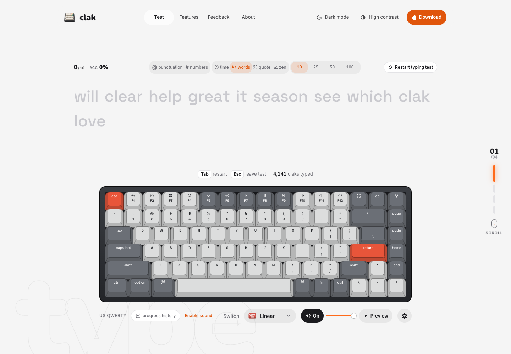

# Clak

A typing experience with the look and sound of a mechanical keyboard.

[Try Clak](https://claks.app/) · [Created by Joshua Co](https://github.com/Joshuasoco)

## About

Clak brings typing practice and a responsive keyboard preview together in one
place. Choose a test, turn on a switch sound if you like, and track your speed
and accuracy as you type.

## Features

- **Four typing modes:** timed tests, word-count tests, quotes and untimed zen writing.
- **Mechanical keyboard preview:** keys respond to your typing, with selectable switch sounds.
- **Results and progress:** WPM, accuracy, local progress history and shareable result images.
- **Practice mistakes:** revisit words you missed after a test.
- **Personalisation:** light and dark themes, high contrast and appearance settings.
- **Keyboard tester:** check which physical keys your browser detects.

## Try it

Open [claks.app](https://claks.app/) in your browser. No account is needed to
practise typing. Test preferences and progress history are stored in your
browser.

## Built with

React, TypeScript and CSS Modules, built with Vite and hosted on Cloudflare.

## Source availability

This repository is a public showcase containing the project overview and a
screenshot. Clak's application source code and development history are kept
in a separate private repository.

## Credits and rights

Clak is created and maintained by [Joshua Co](https://github.com/Joshuasoco).
The application uses third-party libraries and assets under their respective
terms; this showcase does not relicense those materials or grant a license
to the application's private source code.

Copyright © 2026 Joshua Co. Rights in the original showcase text and screenshot
are reserved, subject to applicable law and GitHub's terms. Third-party names,
marks and assets remain the property of their respective owners.

## Feedback

Use the Feedback page on [Clak](https://claks.app/#feedback) to share suggestions
or report a problem with the typing experience.
